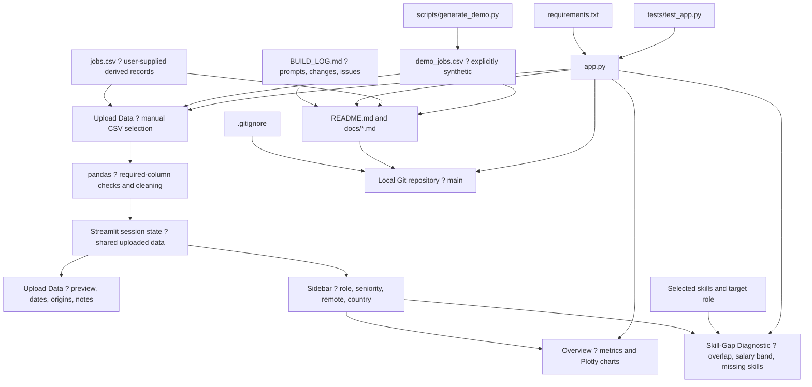

# AI Skill-Gap & Job Market Analyzer - Case Study

## Project Overview

A local Streamlit application explores uploaded job-market CSVs and compares selected skills with listed requirements. Python handles the application, pandas handles tabular data and calculations, and Plotly supplies interactive charts. It has exactly three tabs and requires no API key.

## Problem and Audience

Job seekers and learners need a transparent way to inspect skill demand and identify missing skills for a target role. Instructors can use the explicitly synthetic dataset to demonstrate the workflow, while the original data illustrates why missing fields and provenance matter. Skill overlap is a diagnostic aid, not a hiring prediction.

## Dataset and Data Origin

The user supplied jobs.csv. Its source metadata attributes 20 rows to luke_posting at https://huggingface.co/datasets/lukebarousse/data_jobs and 480 to aijobs_salary at https://huggingface.co/datasets/kestra/datasets/raw/main/csv/salaries.csv. The original extraction/transformation process is absent from this project; the attribution comes from source/source_url fields and has not been independently audited.

| File | Rows | Available dates | Real | Derived | Synthetic |
|---|---:|---|---:|---:|---:|
| jobs.csv | 500 | 2023-01-03 to 2023-11-25 | 0 | 500 | 0 |
| demo_jobs.csv | 120 | 2026-07-01 to 2026-09-28 | 0 | 0 | 120 |

The original file has only 20 available posting dates. Its 20 skill-bearing records lack salaries, while its 480 salary-bearing records lack skills and dates. None can support a salary band conditioned on skill match. Counts are CSV rows, which should not be assumed to be verified current postings.

Every row in demo_jobs.csv is synthetic, generated by scripts/generate_demo.py with the label synthetic and source local_synthetic_demo. No market claim is supported by this demonstration dataset. It has 114 records with skills and 108 with salaries. Neither the original file nor its origins were changed to make the demo work.

## Architecture

Salary bounds are optional. All shared filters default to all values; clearing a filter yields an empty result. Each CSV row counts as a posting. Skills are split on semicolons, trimmed, matched case-insensitively, and deduplicated per posting. Valid positive finite midpoint salaries are used for salary calculations. Roles with no listed skills do not contribute to overlap averages. The salary band spans all filtered records with at least 50% match; the selected target role affects the missing-skills list.

## Step-by-Step Build

The following subsections copy each BUILD_LOG entry's exact prompt, changes, and issue notes. Planning entries were recorded retrospectively once file creation was authorized. Screenshot markers describe real states to capture; they are not assertions that images already exist.

### Build step 01 — Initial setup check
#### Exact prompt
~~~~text
is Codex setup complete to craete and build project
~~~~

#### What changed
- No project files were changed. Checked the connected workspace and tools.
- At that time, a previous Voice of Customer AI project and a working Python 3.14.8 virtual environment were present; its dependency check and imports passed.

#### Bugs and fixes
- No application bug was observed during this check.
- This earlier environment check did not establish the later workspace state. At implementation time, only jobs.csv remained and the previous virtual environment was absent (Entry 11).

### Build step 02 — Approval workflow
#### Exact prompt
~~~~text
I need you to build an app called  "AI Skill-Gap & Job Market Analyzer" and I will provide you the App layout which includes 3 tabs. Pleae ask me for Approval at each planning step and do not build the project code directly with out asking for input
~~~~

#### What changed
- Agreed to plan incrementally and wait for approval before implementation.
- Requested the names, purposes, inputs, and results for three tabs.
- No files or code were created.

#### Bugs and fixes
- None observed.

### Build step 03 — Application specification
#### Exact prompt
~~~~text
**Build a Streamlit app called "AI Skill-Gap & Job Market Analyzer" using Python, pandas, and Plotly. Create app.py, requirements.txt, and a short README.md with run instructions. Also keep a running log in BUILD_LOG.md: after each task I give you, append my exact prompt, what you changed, any bugs and fixes.**\
\
**THE CSV**\
**Columns: job_id, posted_date, title, role_category, seniority, salary_min_usd, salary_max_usd, salary_mid_usd, skills, remote_status, industry, country, source, source_url, data_origin.**\
**The "skills" column holds several skills in one cell, separated by semicolons (e.g. "Python;RAG;Docker"). Split them when needed.**\
\
**The app has exactly 3 tabs:**\
\
**TAB 1 - "Upload Data"**\
**- Let me upload the CSV manually and keep it in session state so all tabs can use it.**\
**- Check that the needed columns exist. If any are missing, show a clear message listing them.**\
**- Show the first 20 rows, the row count, and the date range.**\
**- If the data_origin column has any "synthetic" rows, show a visible warning.**\
**- Until a file is uploaded, the other two tabs should say "Please upload a CSV in the first tab."**

**Dont build it yet. Give me a overall structire and plan first**\
\
**TAB 2 - "Overview"**\
**- Sidebar filters: role_category, seniority, remote_status, country. They also apply to Tab 3. If filters leave no rows, show a friendly message instead of an error.**\
**- Metric cards: number of postings, median salary (USD per year), % remote, % of postings with a listed salary. Show units on every metric.**\
**- Bar chart of the top 10 skills by posting count.**\
**- Pie or bar chart of the role mix.**\
**- Every chart needs a title and axis labels.**\
\
**TAB 3 - "Skill-Gap Diagnostic"**\
**- A checklist (multiselect) of all skills so I can pick the ones I have, plus a dropdown for my target role.**\
**- Match % by role: for each posting, the share of its skills I already have, averaged across all postings in that role. Show a ranked bar chart.**\
**- Salary band: the 25th to 75th percentile of salary_mid_usd for postings where my match is 50% or higher.**\
**- Top 5 missing skills for my target role, ranked by how often they appear in that role's postings. Show the number of postings behind each.**\
**- If I haven't picked any skills, show a friendly prompt instead of empty charts.**\
\
**GENERAL RULES**\
**- Don't crash when salaries are missing. Skip those rows in salary calculations.**\
**- Add short comments explaining each section of the code.**\
**- When done, tell me exactly how to run the app.**
~~~~

#### What changed
- Proposed the file structure and three-tab data flow.
- Planned CSV validation, shared filters, explicit metric units, skill-overlap calculations, and friendly empty states.
- Proposed a separate application folder while a previous app was believed present. At implementation time the workspace contained only jobs.csv, so the new project was built directly in that existing project root without replacing an existing app.
- No code was written at this planning stage.

#### Bugs and fixes
- None observed.

### Build step 04 — Visual structure
#### Exact prompt
~~~~text
is it  quick to provide visual structure
~~~~

#### What changed
- Provided text wireframes for Upload Data, Overview, and Skill-Gap Diagnostic.
- Showed shared sidebar filters, metric cards, charts, controls, and missing-skill counts.
- No implementation changes.

#### Bugs and fixes
- None observed.

[INSERT SCREENSHOT: docs/screenshots/planning_layout.png ? the actual planning conversation wireframe]

### Build step 05 — Layout approval and file requirements
#### Exact prompt
~~~~text
Yes. This looks good. but I need to provide details of what files I need before you start implementing
~~~~

#### What changed
- Recorded approval of the visual layout.
- Continued waiting for file requirements and explicit implementation authorization.

#### Bugs and fixes
- None observed.

[INSERT SCREENSHOT: docs/screenshots/planning_layout.png ? the approved layout from the conversation]

### Build step 06 — Submission-material requirements
#### Exact prompt
~~~~text
When the app is finished. Please create all my submission materials from the project files and BUILD_LOG.md. Create these files exactly, and do not invent anything that isn't in the project or the log.\
\
1\. README.md (for GitHub)\
\- Project title and a 2-sentence description of what the app does and who it's for\
\- Features, listed by tab\
\- A "Data" section: where jobs.csv came from, the date range, row count, and the real / derived / synthetic split (read it from the data_origin column). If any rows are synthetic, say so clearly.\
\- Setup and run steps (pip install -r requirements.txt, then streamlit run app.py)\
\- How to set the optional API key, without showing any real key\
\- A placeholder line for screenshots: ![Overview]\(docs/screenshots/overview\.png), and the same for the other tabs\
\- A "Limitations" section (salary data is sparse, skill pay premiums show correlation not causation, match % is a simple overlap measure, and synthetic data if used)\
\- A "Built with AI" section: which coding assistant I used, and a link to docs/CASE_STUDY.md\
\
2\. docs/CASE_STUDY.md (this becomes my Google Doc)\
Sections: Project Overview, Problem and Audience, Dataset and Data Origin, Architecture (include a Mermaid diagram of tabs, data flow, and files), Step-by-Step Build (one subsection per entry in BUILD_LOG.md, with my exact prompt, what changed, and a line like "[INSERT SCREENSHOT: ...]" wherever a screenshot belongs), Bugs and Fixes (a table with Bug, Cause, Fix), Learnings About Vibe Coding, Limitations, and Next Steps. Use only what is in BUILD_LOG.md for the build steps and bugs.\
\
3\. docs/DEMO_SCRIPT.md (for my 5-minute video)\
A timed script with these parts: 0:00-0:30 the problem, 0:30-1:30 how I used the AI coding tool (point to one real prompt and one real bug from the log), 1:30-4:00 live walkthrough of the three tabs (upload, overview, skill-gap diagnostic including the capstone generator), 4:00-4:40 limitations and honesty about the data, 4:40-5:00 learnings and next steps. Add exact click-by-click actions for the demo, and a "Before recording" checklist.\
\
4\. docs/SCREENSHOT_CHECKLIST.md\
A numbered list of every screenshot I need, with the exact file name to save it as under docs/screenshots/, which tab or state to show, and which build step it belongs to. Include screenshots of at least: each tab working, one bug before the fix, the same screen after the fix, the sidebar filters, an empty-filter message, and the capstone result.\
\
5\. .gitignore\
Ignore \_\_pycache\_\_, .venv, .env, .streamlit/secrets.toml, and .DS_Store. Make sure no API key is stored anywhere in the code or repo.\
\
6\. docs/SUBMISSION_CHECKLIST.md\
A checklist of the three deliverables: Google Doc, video demo (5 minutes or less), and GitHub link, with the steps to finish each.\
\
Finally, list every file you created and anything I must do manually.
~~~~

#### What changed
- Added all six requested submission files to the delivery plan.
- Identified that the capstone generator and API integration needed clarification.
- Committed to documenting actual evidence only, including real bugs and explicit screenshot placeholders.

#### Bugs and fixes
- None observed. The capstone reference was subsequently withdrawn in Entry 07.

### Build step 07 — Dataset and scope clarification
#### Exact prompt
~~~~text
1) Yes I have uploaded the csv file in the project folder.
2) Capstonde generator please ignore, this was provided by mistake. We dont need this feature.
3) Not sure whta the A{PI key is for

before you proceed let me know if the requoirement is clear
~~~~

#### What changed
- Confirmed jobs.csv exists, has 500 rows, and contains 500 derived-origin labels.
- Found salary_min_usd and salary_max_usd absent; proposed making them optional.
- Removed the capstone generator from application and submission scope.
- Explained that the approved local calculations need no external AI service or API key.

#### Bugs and fixes
- Read-only inspection using the previous .venv path failed because that environment was no longer present. Used PowerShell Import-Csv to complete the inspection without modifying the dataset.
- No application bug existed at this stage.

[INSERT SCREENSHOT: docs/screenshots/original_data.png ? actual original-data upload and origin counts]

### Build step 08 — Salary-column clarification
#### Exact prompt
~~~~text
do you need data for these columns`salary_min_usd` and `salary_max_usd`  
~~~~

#### What changed
- Explained that the median, salary-availability percentage, and percentile band use salary_mid_usd only.
- Proposed keeping the two bounds optional without estimating missing values in jobs.csv.

#### Bugs and fixes
- None observed.

### Build step 09 — Optional-column approval
#### Exact prompt
~~~~text
Yes
~~~~

#### What changed
- Recorded approval to make salary_min_usd and salary_max_usd optional.
- Presented calculation rules: shared filters, row-based posting counts, valid positive midpoint salaries, Remote-only numerator, case-insensitive deduplicated skills, per-posting overlap averaged by role, no-skill exclusions, salary bands across all qualifying filtered roles, and top missing-skill counts.

#### Bugs and fixes
- None observed.

### Build step 10 — Streamlit API-key question
#### Exact prompt
~~~~text
Since we need to Build a Streamlit app called "AI Skill-Gap & Job Market Analyzer", do you need the API key for stremlit or we are good
~~~~

#### What changed
- Verified Streamlit's local setup in its official installation documentation.
- Confirmed no API key is required for this local application.
- Requested approval of the outstanding calculation rules.

#### Bugs and fixes
- None observed.

### Build step 11 — Implementation authorization
#### Exact prompt
~~~~text
Yes please go ahead and start biuilding
~~~~

#### What changed
- Recorded approval of the calculation rules and authorization to implement.
- Created app.py, requirements.txt, .gitignore, and behavior tests in tests/test_app.py.
- Implemented exactly three tabs, manual CSV ingestion, session state, validation messages, shared filters/reset, all requested metrics and Plotly charts, target-role missing skills, and salary-band calculations.
- Kept synthetic warnings visible both in upload details and outside the tab bodies.
- Added protection against missing/invalid dates, missing/nonpositive/infinite salaries, empty files, no listed skills, empty filter selections, stale uploads, and target roles disappearing after a filter change.
- Preserved the original jobs.csv.
- Dataset inspection found 20 rows with skills but no salary and 480 rows with salary but no skills. The original data cannot support a matched-posting salary band; the UI reports this instead of estimating one.
- Located a managed Python 3.14.8 runtime and created a new project-local .venv. Installed dependencies to enable verification.
- Submission documents were generated after verification, using this log and the final project files.

#### Bugs and fixes
- Environment issue: the python command resolved to the Microsoft Store alias and reported "Python was not found." Cause: no working interpreter on PATH and the earlier .venv absent. Fix: locate uv's managed interpreter and create the project-local .venv, then use its explicit Python path.
- Permission issue: uv python find failed to access its cache. Fix: rerun the lookup with approved access.
- Environment issue: virtual-environment creation initially failed during ensurepip. Fix: rerun environment creation with approved access.
- Dependency issue: sandboxed pip reported no matching Streamlit distribution because the package index was unavailable. Fix: rerun installation with approved network access.
- Verification issue: the first test invocation ran while pip was still installing and reported ModuleNotFoundError for pandas. Fix: wait for dependency installation to finish before running the suite again.
- These are actual observed environment/verification issues, not invented application bugs. Final application findings and verification results are appended below after testing.
- Application warning found during the first completed interface run: Reset filters assigned widget Session State while the same multiselect also declared a default, producing a Streamlit default/state conflict warning. Fix: initialize each filter's Session State once and omit the conflicting widget default. Added a regression assertion that resetting filters shows no default-value warning.
- API compatibility warning: Streamlit reported that use_container_width was deprecated. Fix: replaced it with width="stretch" and pinned the three dependencies to the installed versions for reproducible setup.
- Test-environment issue: Windows denied cleanup of an AppTest temporary directory at interpreter shutdown. The checks themselves passed, but verification was rerun with approved temporary-directory access after the application warning fixes.

[INSERT SCREENSHOT: docs/screenshots/no_upload.png ? no-upload prompt]

[INSERT SCREENSHOT: docs/screenshots/upload_data.png ? working Upload Data]

[INSERT SCREENSHOT: docs/screenshots/overview.png ? working Overview]

[INSERT SCREENSHOT: docs/screenshots/sidebar_filters.png ? shared filters]

[INSERT SCREENSHOT: docs/screenshots/empty_filter.png ? no selected countries]

[INSERT SCREENSHOT: docs/screenshots/no_skills_selected.png ? selection prompt]

[INSERT SCREENSHOT: docs/screenshots/skill_gap_diagnostic.png ? working diagnostic]

[INSERT SCREENSHOT: docs/screenshots/salary_unavailable.png ? original data with selected skills]

[INSERT SCREENSHOT: docs/screenshots/bug_before_fix.png ? labeled reproduction of the recorded Python alias issue, if reproducible; no historical screenshot was captured]

[INSERT SCREENSHOT: docs/screenshots/bug_after_fix.png ? same terminal with the explicit local Python executable working]

[INSERT SCREENSHOT: docs/screenshots/tests_passed.png ? final nine passing checks]

### Build step 12 — Mock-data authorization
#### Exact prompt
~~~~text
This is a demo application fill in the mock data if needed
~~~~

#### What changed
- Created scripts/generate_demo.py and used it to create demo_jobs.csv with 120 reproducible mock rows.
- Every demo row has data_origin=synthetic and source=local_synthetic_demo; no external source URL is fabricated.
- Included varied roles, skills, salaries, seniorities, remote statuses, and countries, plus missing-salary and missing-skill cases.
- Added a synthetic-demo CSV download in Upload Data; it must still be manually uploaded.
- Kept jobs.csv and demo_jobs.csv separate. Salary bounds in the demo are invented mock values, never estimates of the original rows.
- Final submission materials distinguish the original derived data from synthetic demonstration data.

#### Bugs and fixes
- No new bug was observed during generation. Mock data resolves the demonstration's coverage limitation without misrepresenting the original dataset.

#### Validation and final dataset facts
- Original jobs.csv: 500 rows; real=0, derived=500, synthetic=0. Source labels: luke_posting=20 and aijobs_salary=480. Available posting dates: 2023-01-03 through 2023-11-25, from 20 rows; 480 dates are missing. Skills are listed on 20 rows; valid midpoint salaries on 480. No row has both skills and salary.
- demo_jobs.csv: 120 rows; real=0, derived=0, synthetic=120. Dates: 2026-07-01 through 2026-09-28. Skills appear on 114 rows, salaries on 108. Values were generated locally by scripts/generate_demo.py and are not market observations.
- With Python, SQL, and Docker selected and all demo filters reset: median salary=$110,500/year; remote=33.3%; salary availability=90.0%; qualifying salary sample=70 rows; 25th–75th percentile band=$88,000–$142,500/year. For target AI Engineer, missing skills are RAG (24 postings) and LLM Evaluation (8 postings).
- Final verification: 9 automated checks passed after the warning fixes; Python syntax compilation passed; pip check reported no broken requirements.
- Streamlit AppTest exercises CSV ingestion through an in-memory file-uploader substitute and real filter/selection widgets. It does not automate a browser's native file picker or capture screenshots. Bare-mode ScriptRunContext notices from the test harness remain informational, with no application exceptions.
- Live Streamlit server started on http://127.0.0.1:8501. Both its health endpoint and app page returned HTTP 200; health body was "ok".
- Created README.md, docs/CASE_STUDY.md, docs/DEMO_SCRIPT.md, docs/SCREENSHOT_CHECKLIST.md, docs/SUBMISSION_CHECKLIST.md, and the screenshot-folder placeholder. Screenshots, Google Doc creation, video recording, and GitHub publishing remain manual tasks; no completed external submission is claimed.

[INSERT SCREENSHOT: docs/screenshots/upload_data.png ? synthetic warning visible]

[INSERT SCREENSHOT: docs/screenshots/salary_band_missing_skills.png ? synthetic salary band and missing skill counts]

### Build step 13 — Local version control
#### Exact prompt
~~~~text
Initialize a local git repository and track changes . we will push to Github later
~~~~

#### What changed
- Added local Git initialization and an initial project commit to the authorized work.
- GitHub publishing is deferred, as requested. Repository verification results are appended after initialization.
- Initialized a local repository with main as its initial branch. No remote was added.
- Found Git 2.53.0 bundled with GitHub Desktop; the existing global author name and email are configured.
- The requested submission documents are prepared locally; screenshot PNGs are still manual placeholders.
- Created initial commit e6f20d3 (Build skill-gap analyzer with synthetic demo and submission materials), tracking 14 files including the original user-supplied jobs.csv and 13 newly created project/material files.
- Verified that .venv, Python caches, .env, .streamlit/secrets.toml, and .DS_Store are ignored. No remote is configured.
- Checked that all 13 exact prompts in the case study match this log. A recognizable-credential-literal scan of created project files found no matches; no key was supplied or needed.
- Updated this log and its corresponding case-study step to record the successful initial commit; these documentation updates are tracked in the local repository as well.

#### Bugs and fixes
- Git was not on the PowerShell PATH. Used GitHub Desktop's existing bundled git.exe rather than installing another copy.
- Repository initialization required approved access because this workspace restricts writes to .git.
- Documentation tooling issue: refreshing the case-study Git step failed because a Unicode section delimiter was altered when a PowerShell string was piped to Python. Fix: match section boundaries using ASCII prefixes, then regenerate the affected build steps from the log and verify exact prompts again.

[INSERT SCREENSHOT: docs/screenshots/local_git.png - actual initial commit and main branch]

### Build step 14 — High-level demo architecture
#### Exact prompt
~~~~text
Can you prvide a quick architecture ASCII diagram for the demo here . Keep it high level
~~~~

#### What changed
- Provided an ASCII diagram in the conversation: original CSV or synthetic demo CSV → Upload Data validation/preview → shared session state → shared filters → Overview and Skill-Gap Diagnostic.
- Explained that Streamlit provides the interface, pandas handles calculations, and Plotly displays charts.
- No application code or calculation rules changed.

#### Bugs and fixes
- None observed for this diagram request.

## Bugs and Fixes

This table reports only issues recorded in BUILD_LOG. Environment issues and compatibility warnings are distinguished from a fabricated application crash.

| Bug / issue | Cause recorded in log | Fix recorded in log |
|---|---|---|
| Old virtual-environment path unavailable (Entry 07) | Previous environment no longer present | Used PowerShell Import-Csv to inspect the uploaded file |
| Python command reported Python was not found (Entry 11) | Windows Store alias on PATH; earlier environment absent | Located managed Python and created a project-local virtual environment; used its explicit executable |
| uv lookup denied cache access (Entry 11) | Workspace access restrictions | Reran lookup with approved access |
| Virtual-environment ensurepip failed (Entry 11) | Restricted environment setup | Reran setup with approved access |
| pip reported no matching Streamlit distribution (Entry 11) | Package index unavailable in sandbox | Installed with approved network access |
| Initial test import reported no pandas (Entry 11) | Test invoked before installation completed | Waited for installation before rerunning tests |
| Reset filters triggered a default/state conflict warning (Entry 11) | Widget declared a default while its Session State value was assigned | Initialized Session State once, removed conflicting default, added a regression assertion |
| Deprecated chart/table sizing warning (Entry 11) | use_container_width was obsolete in installed Streamlit | Used width='stretch' and pinned tested versions |
| AppTest temporary-directory cleanup denied (Entry 11) | Windows sandbox denied cleanup at interpreter shutdown | Reran verification with approved temporary-directory access |
| Bare git command unavailable (Entry 13) | Git was absent from PowerShell PATH | Used GitHub Desktop's existing bundled Git executable |
| Case-study section refresh failed (Entry 13) | Unicode delimiter changed while piping a PowerShell string to Python | Used ASCII section prefixes and regenerated affected steps |

The original dataset's missing skill/salary overlap is a data limitation, not a software bug. Nine final behavior checks, syntax compilation, and dependency validation passed. The live app and health endpoint returned HTTP 200. The tests use an in-memory uploader substitute and do not certify native browser file selection or screenshots.

## Learnings About Vibe Coding

- An approved wireframe and explicit calculation rules gave the coding assistant concrete behavior to implement; planning occurred before authorization to write code.
- Inspecting the actual CSV exposed a limitation that a column list alone did not reveal: salaries and skills never co-occurred.
- Synthetic mock data made the full workflow demonstrable, while separate files and visible warnings preserved the distinction from original records.
- Environment readiness can change between turns. Explicit interpreter paths and a local virtual environment resolved the recorded Windows alias issue.
- Behavior tests exercised empty states, normalization, filters, reset behavior, and missing data. They also exposed warnings that were fixed before final verification.
- Exact prompts and observed fixes support an evidence-based case study. Missing screenshots or provenance details should remain explicit gaps.

## Limitations

Salary coverage is absent in the original skill-bearing subset, despite 480 of 500 original rows listing salaries. Historical records, missing dates, mixed source categories, and limited skill coverage prevent representative live-market conclusions. The source transformations are not documented in this repository.

Skill match is simple overlap, not skill depth, semantic equivalence, or a hiring probability. No skill-pay-premium feature is implemented; future premium analysis would indicate correlation, not causation. Salary bands describe available qualifying rows, not personal salary predictions.

The demonstration dataset is wholly synthetic. Uploads are session-scoped. There is no capstone generator, external AI API integration, or live scraping. Native browser upload, screenshot capture, Google Doc creation, video recording, and GitHub publication remain manual review/submission tasks.

## Next Steps

These are proposals, not completed work:

1. Obtain a documented dataset with skills and salaries on the same real records.
2. Document extraction and derivation history, coverage, and refresh dates.
3. Review optional skill aliases and proficiency inputs before changing the match formula.
4. Capture screenshots, create the Google Doc, and record the timed video using the prepared checklists.
5. Publish the local Git repository to GitHub later, as requested, and add actual submission links.
